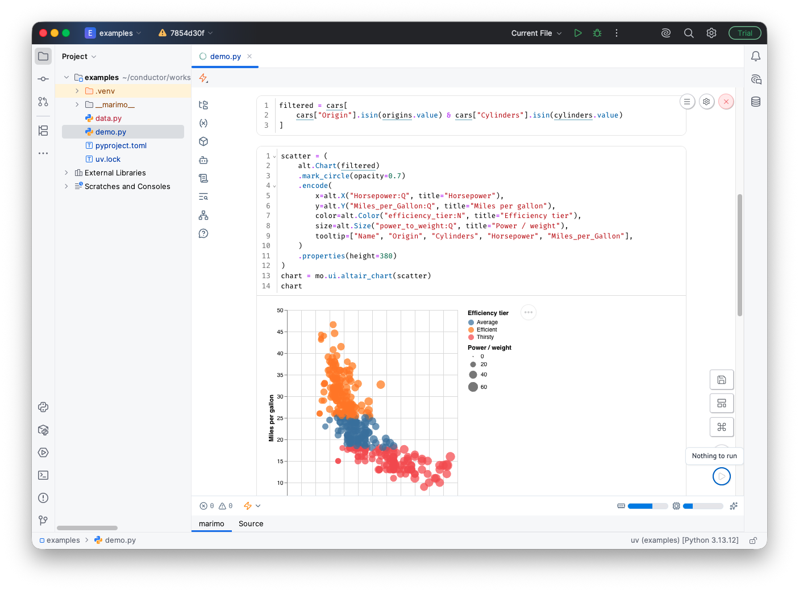
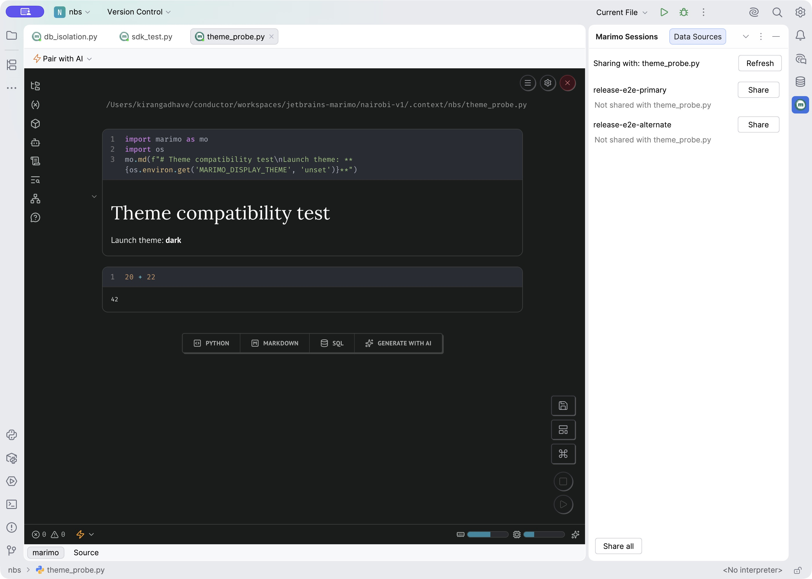
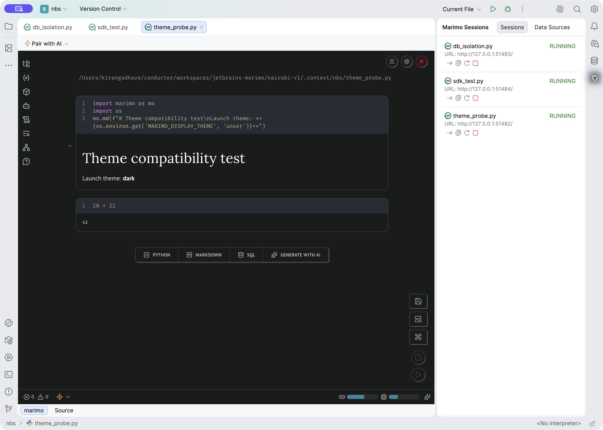

[](https://plugins.jetbrains.com/plugin/32416-marimo)

# marimo for PyCharm

Open and run [marimo](https://marimo.io) notebooks directly in PyCharm.

Keep notebooks as plain Python files. Edit reactive cells, use interactive widgets, and manage packages in a dedicated notebook tab.



## Features

- **Interactive notebooks:** reactive cells, `mo.ui` widgets, SQL, variables, dependencies, and package management.
- **Project interpreter or sandbox:** use your Python interpreter, or start an isolated [uv](https://docs.astral.sh/uv/) environment.
- **Persistent sessions:** split editors share a notebook session. Closing a tab preserves the session until its idle timeout.
- **Database sharing:** share IDE data sources with individual notebooks from **Marimo Sessions**.
- **Pair with AI:** start a supported terminal harness for a notebook, or copy its pairing prompt.
- **Source editing:** switch between Python source and the notebook. Source edits reload in marimo.
- **Recovery actions:** use **Retry**, **Install**, or **Open as Python File** when startup fails.
- **Notebook template:** choose **New → marimo Notebook** to create a notebook.

## Requirements

- PyCharm 2026.1 or later (Community or Professional)
- A project interpreter with marimo installed — the plugin runs marimo on your configured interpreter,
  and offers to install it for you if it's missing
- [uv](https://docs.astral.sh/uv/) (optional) — only needed to run a notebook in an isolated sandbox
- PyCharm Professional with Database Tools (optional) — only needed to share IDE data sources

## Getting started

1. Install the plugin.
2. Open a folder containing a marimo notebook.
3. Open the notebook `.py` file — it loads in the marimo editor.
4. Edit and run cells; results update reactively.

A minimal marimo notebook:

```python
import marimo

app = marimo.App()

@app.cell
def _():
    import marimo as mo
    return (mo,)

if __name__ == "__main__":
    app.run()
```

If a `.py` file isn't a marimo notebook, it opens in the normal Python editor as usual.

## Share a database connection

In **Marimo Sessions → Data Sources**, select a notebook and share an IDE data source.
Choose one default per database family. With marimo 0.23.16 or later, **Quick Add** can suggest a SQL cell for that default.

The notebook process can read shared credentials. The plugin reads passwords from the IDE credential store at launch and keeps them out of project files and logs.
If a shared source changes, restart the session to apply the new connection settings.



## Themes

Explicit notebook, project, and user themes stay unchanged. A `system` theme uses the IDE theme.
If an IDE theme change does not update the notebook, restart its session from **Marimo Sessions**.



## Development

You need JDK 21 or later; Gradle is provided through the wrapper. To launch a
sandboxed PyCharm instance with the plugin loaded, run:

```bash
./gradlew runIde
```

See the [common command reference](AGENTS.md#common-commands) and the full
[contributor guide](CONTRIBUTING.md) for setup, testing, and local marimo
development.

## Feedback

Bug reports and ideas are welcome via the issue tracker. Interest in marimo support for PyCharm is also tracked upstream at [JetBrains PY-78283](https://youtrack.jetbrains.com/issue/PY-78283/Add-UI-support-for-Marimo).

---
Plugin based on the [IntelliJ Platform Plugin Template][template].

[template]: https://github.com/JetBrains/intellij-platform-plugin-template
